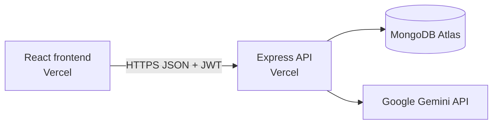

# Peer Tutoring Booking Platform

A React and TypeScript frontend where students can find tutors, manage bookings, and use Gemini-powered session preparation through the private Express API.

- Live frontend: https://itelect4-project-self.vercel.app
- Live API health: https://itelect4-backend-five.vercel.app/api/health

## Architecture

## Run locally

Requires Node.js 24 and npm.

1. Run `npm install`.
2. Copy `.env.example` to `.env` and set `VITE_API_URL` to the backend URL, normally `http://localhost:4000`.
3. Run `npm run dev` and open the URL printed by Vite.

Use `npm test` for the Vitest suite, `npm run typecheck` for TypeScript checks, and `npm run build` for the production build.

## AI-use disclosure

ChatGPT/Codex assisted with implementation, testing, CI configuration, and documentation. The author reviewed the generated changes, ran the local verification commands, and remains responsible for the submitted work.
